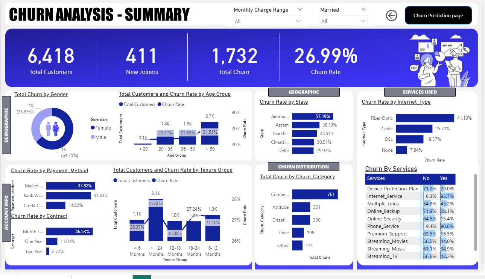
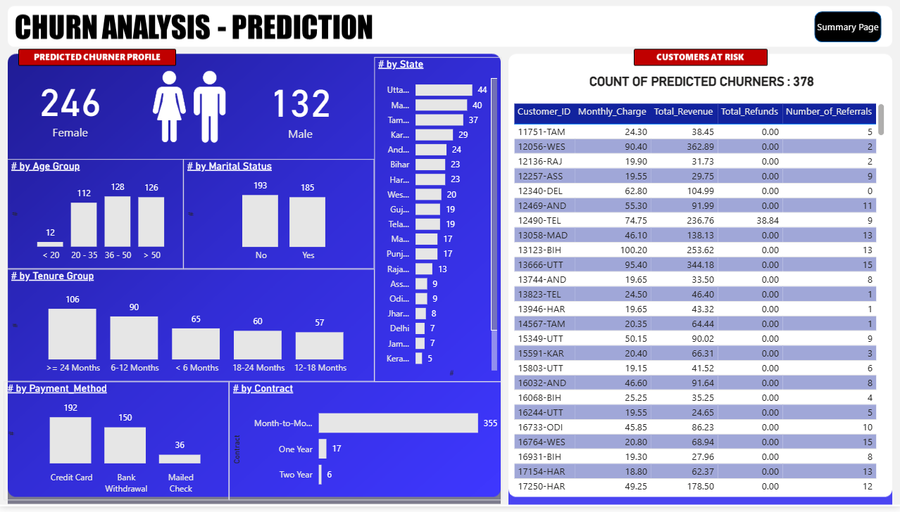

# 📊 Customer Churn Prediction using Random Forest Algorithm  

## 🧠 Overview  
This project focuses on predicting **customer churn** — identifying customers who are likely to stop using a company’s service.  
By applying the **Random Forest Algorithm**, a supervised machine learning technique, and performing **data analytical** and **exploratory data analysis (EDA)** processes, the model helps businesses proactively take retention actions.  

---

## 🎯 Objective  
The main objective of this project is to analyze customer behavior and identify potential churners using **predictive modeling** and **data-driven insights**.  
This prediction helps organizations improve **customer retention**, **marketing strategy**, and **business growth**.  

---

## 🧩 Key Features  
- Implemented **Random Forest Classification Algorithm** for accurate churn prediction.  
- Conducted **Data Cleaning**, **Exploratory Data Analysis (EDA)**, and **Feature Engineering** to improve model performance.  
- Visualized patterns and customer insights using **data analytical libraries**.  
- Evaluated model performance with accuracy, precision, recall, and F1-score metrics.  

---

## ⚙️ Technologies and Libraries Used  
- **Programming Language:** Python  
- **Data Handling:** Pandas, NumPy (Numerical Python)  
- **Visualization:** Matplotlib, Seaborn  
- **Machine Learning:** Scikit-learn (Scientific Kit for Machine Learning)  
- **Model Used:** Random Forest Classifier  

---

## 📂 Dataset  
The dataset includes information about customers such as demographics, account activity, and service usage patterns.  
It is preprocessed to handle missing values, categorical variables, and class imbalance.  

---

## 📸 Project Visuals  

### 🖼️ 1. Data Visualization Output  

---

### 🖼️ 2. Model Evaluation and Prediction Results  

---

## 🚀 Steps Involved  

1. **Data Collection:** Imported and examined the raw dataset.  
2. **Data Cleaning:** Removed duplicates, handled missing values, and standardized categorical data.  
3. **Exploratory Data Analysis (EDA):** Explored patterns, visualized churn distribution, and identified influencing factors.  
4. **Feature Engineering:** Created and selected relevant features to enhance predictive capability.  
5. **Model Training:** Implemented Random Forest Classifier and trained it using the processed dataset.  
6. **Model Evaluation:** Assessed model performance using confusion matrix and evaluation metrics.  
7. **Prediction:** Predicted churn probability for new or existing customers.  

---

## 📈 Results  
- Achieved high accuracy and reliability in identifying potential churn customers.  
- Provided actionable insights for targeted customer retention strategies.  
- Enhanced understanding of customer behavior through data-driven analytics.  

---

## 🧮 Future Enhancements  
- Integration with real-time data pipelines for continuous monitoring.  
- Deployment as a web application or dashboard using **Flask** or **Streamlit**.  
- Testing with **Gradient Boosting** and **XGBoost (Extreme Gradient Boosting)** models for performance comparison.  

---

## 👨‍💻 Author  
**Tarun Kumar**  
Passionate about Senior Assosiate Manager, Machine Learning models, and Data Analytics. 
Feel free to connect or collaborate on data-driven projects.  

---
